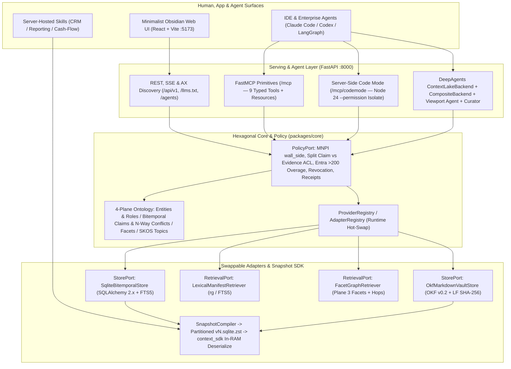
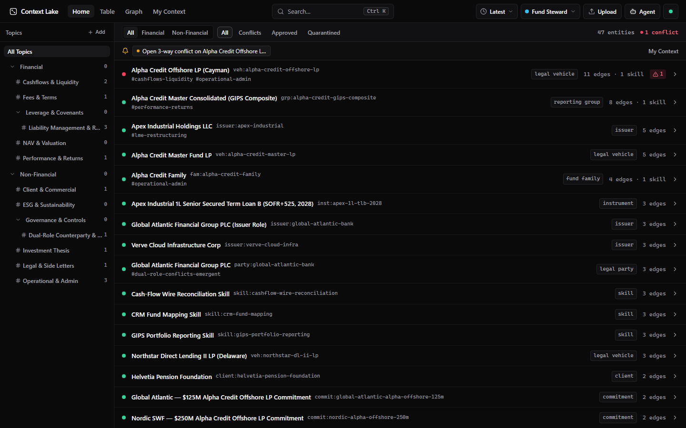
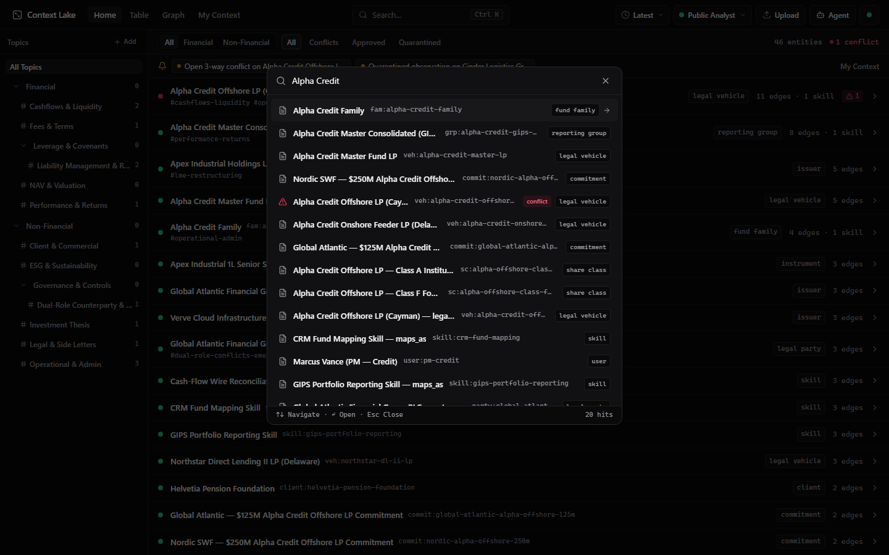
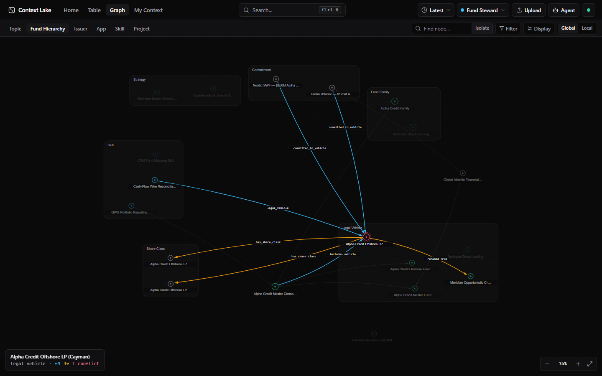
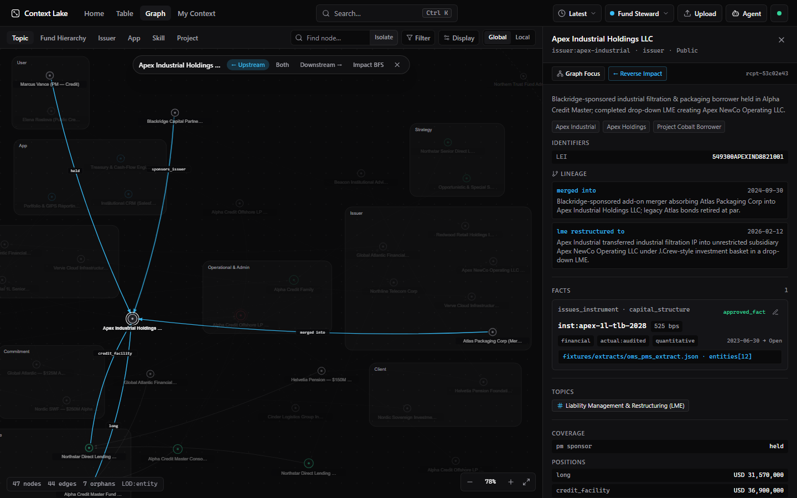
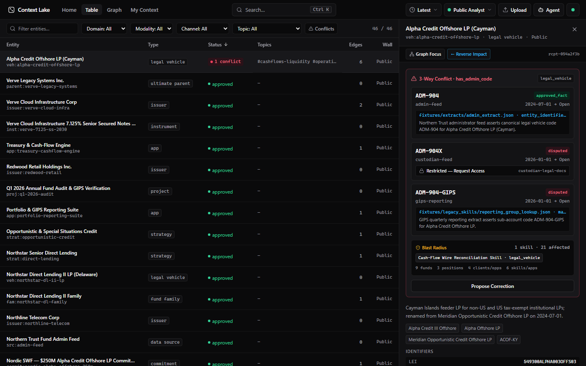
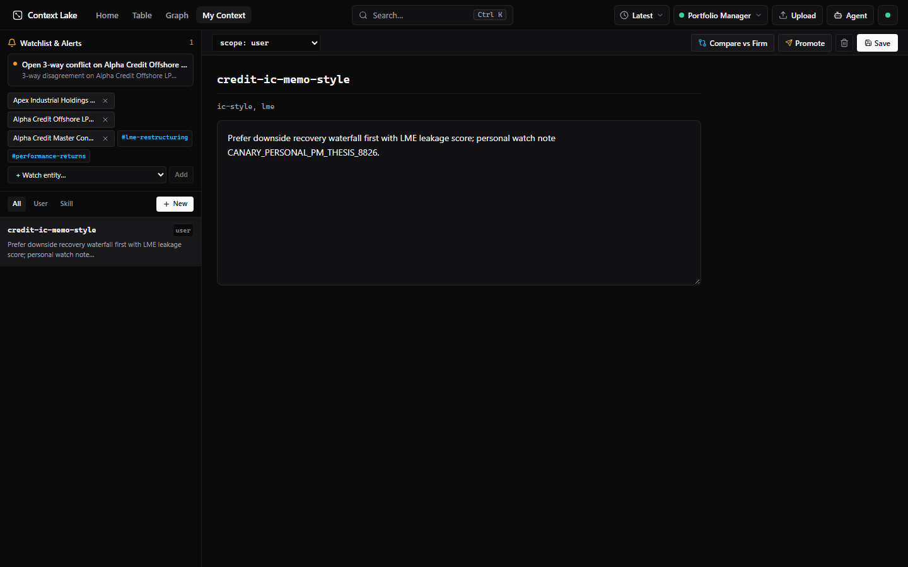
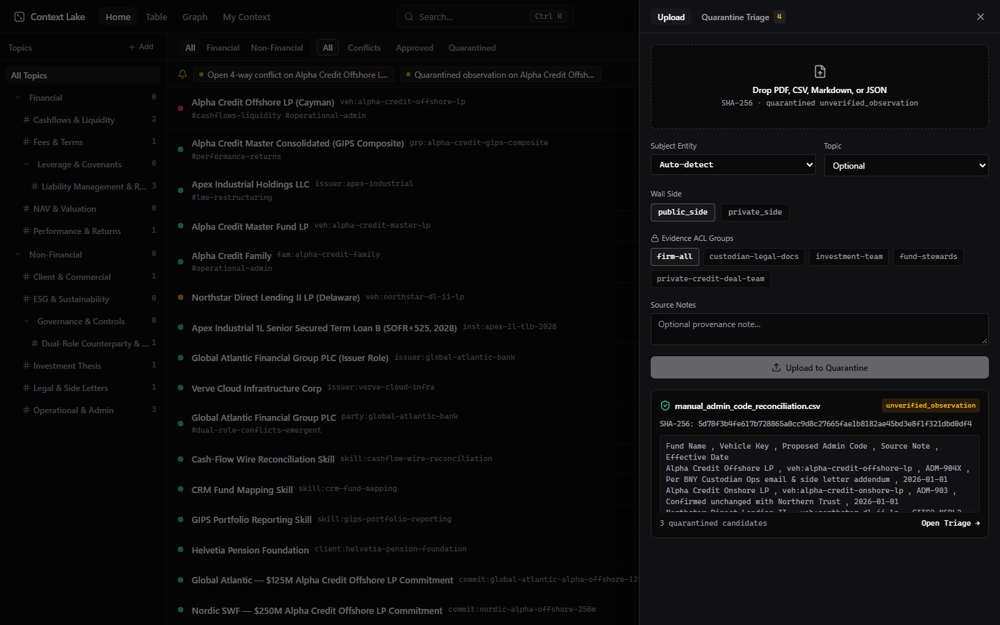

# Enterprise Context Lake

Bitemporal institutional knowledge substrate for investment firms, combining a four-plane ontology (FIBO/GLEIF/OpenFIGI-aligned), fail-closed MNPI information barriers with decoupled claim/evidence redaction, hexagonal swappable stores and retrievers, Zstd-compressed in-RAM SQLite snapshots (`context_sdk`), dual FastMCP surfaces (`/mcp` primitives + `/mcp/codemode` zero-egress Node 24 sandbox), a DeepAgents `BackendProtocol` harness, and a dark obsidian diagnostic workspace.

## Architecture



### Key Architectural Invariants

- **Four-Plane Ontology ([ADR-001](docs/adr/ADR-001-ontology-and-bitemporal-model.md)):** Canonical entities with party/role separation (single GLEIF `legal_party` acting simultaneously as Issuer, LP Client, and ISDA Counterparty), unheld issuers (`watchlist`, `pipeline`, `benchmark`, `passed`) independent of funds, true bitemporal queries (`as_of` business time + `recorded_as_of` system time fixing historical `superseded_at` reads), N-way `ConflictSet` preserving active `approved_fact`, orthogonal Plane 3 facets, dynamic CRUD SKOS topics, and two-channel stratified precedence (`facts` vs. `directives`).
- **Hexagonal Dual Adapters & Safe SDK ([ADR-002](docs/adr/ADR-002-hexagonal-ports-and-adapters.md)):** Identical `StorePort` (`SqliteBitemporalStore` & `OkfMarkdownVaultStore`) and `RetrievalPort` (`LexicalManifestRetriever` & `FacetGraphRetriever`) contracts verified by Hypothesis property tests, plus async non-blocking Zstd snapshot compilation (`compression.zstd`) loaded into RAM via `sqlite3.Connection.deserialize()` with ref-counted atomic swaps and strict `pinned_version` isolation.
- **Zero-Leakage Security & Receipts ([ADR-003](docs/adr/ADR-003-security-mnpi-acls-and-identity.md)):** Fail-closed `wall_side` (`public_side` / `private_side` / `above_the_wall`) barriers, `404` on unauthorized entity lookups, pre-aggregation post-ACL counts, decoupled evidence redaction (`Restricted — Request Access` with URI/excerpt stripped server-side), Entra JWT/JWKS + `>200`-group overage resolution, `401` revocation enforcement, shared-channel/service-actor memory gating, steward RBAC (`403`), TOCTOU `expected_data_epoch` (`409`), and immutable SHA-256 `ContextAssemblyReceipt`s.
- **Dual FastMCP, Code Mode & DeepAgents ([ADR-004](docs/adr/ADR-004-dual-mcp-codemode-and-agents.md)):** Typed `/mcp` primitives alongside `/mcp/codemode` executing inside a stripped-env Node 24 `--permission --max-old-space-size=64` isolate with allowlisted NDJSON host RPC, anti-SSRF URI checks, query-string secret stripping, and `64 KiB` output caps; DeepAgents `ContextLakeBackend(BackendProtocol)` mounted under `CompositeBackend` (`/knowledge/`, `/skills/`, `/memories/`, `/`) plus zero-LLM SHA-256 staleness diffing and background Curator draft patches.

## Windows Quickstart

Prerequisites: `.venv` (Python 3.14+), Node.js 24+ (for Vite frontend, Node `--permission` Code Mode sandbox, and Playwright E2E). All verification suites run 100% offline with zero API keys required.

### 1. Start Local Dev Servers (FastAPI `:8000` + Vite `:5173`)

```powershell
# PowerShell wrapper (or use -ExecutionPolicy Bypass if local script policy restricts unsigned .ps1)
.\scripts\dev.ps1

# Direct Python invocation (recommended when PowerShell ExecutionPolicy blocks .ps1)
.\.venv\Scripts\python.exe scripts/dev.py
```

Endpoints started locally:
- Web Workspace: `http://127.0.0.1:5173`
- FastAPI / OpenAPI 3.1: `http://127.0.0.1:8000/docs` (`GET /healthz`, `GET /llms.txt`, `GET /agents`)
- FastMCP Primitives (Streamable HTTP): `http://127.0.0.1:8000/mcp`
- FastMCP Server-Side Code Mode: `http://127.0.0.1:8000/mcp/codemode`

Child process trees (Uvicorn + Vite) are bound to Win32 Job Objects (`KILL_ON_JOB_CLOSE`) for clean port `8000`/`5173` teardown on exit or `Ctrl+C`.

### 2. Run All 7 Automated Verification Oracles (100% Offline)

```powershell
# PowerShell wrapper
.\scripts\verify.ps1

# Direct Python invocation
.\.venv\Scripts\python.exe scripts/verify.py
```

Writes machine-readable reports to `data/local/verify_summary.json` and `data/local/eval_mcp_vs_codemode.json` (gitignored).

### 3. Optional `.env` Configuration (Live Gemini & LangSmith)

By default (`llm_mode=auto`), the Viewport Agent and Curator run in `deterministic` offline mode with zero external calls when no API key is configured. To enable live Gemini and LangSmith tracing, place an untracked `.env` file at the repository root:

```dotenv
GEMINI_API_KEY=your-gemini-api-key
# GOOGLE_API_KEY is also recognized
GEMINI_MODEL=gemini-2.5-flash

# Optional LangSmith export of OpenTelemetry traces (ADR-006).
# Only public-side traces are sent; private-side, above-the-wall and unmarked traces never leave.
# Prompt and response content is stripped unless CONTEXT_TRACE_CONTENT=true.
LANGSMITH_API_KEY=your-langsmith-api-key
LANGSMITH_PROJECT=enterprise-context-lake
CONTEXT_TRACING_LANGSMITH=true
# LangChain callback tracing of public-side model calls (inputs/outputs hidden by default)
LANGSMITH_TRACING=true

# Optional internal OTLP collector that receives every trace, unfiltered. Firm-run infrastructure only.
CONTEXT_TRACING_INTERNAL_OTLP_ENDPOINT=http://otel-collector.internal:4318/v1/traces
```

## Runtime Adapter Swapping

Both storage and retrieval adapters — as well as LLM execution mode — can be hot-swapped live without restarting FastAPI via `GET/PUT /api/v1/config/adapters` (backed by `AdapterRegistry` / `ProviderRegistry`) or the UI header runtime popover:

```powershell
# Inspect active adapters
Invoke-RestMethod http://127.0.0.1:8000/api/v1/config/adapters -Headers @{ "X-Mock-User" = "user:fund-steward" }

# Hot-swap to OKF v0.2 Markdown Vault + FacetGraphRetriever (syncs live state atomically)
Invoke-RestMethod -Method Put http://127.0.0.1:8000/api/v1/config/adapters `
  -Headers @{ "X-Mock-User" = "user:fund-steward"; "Content-Type" = "application/json" } `
  -Body '{"store":"okf_markdown_vault","retrieval":"facet_graph","llm_mode":"deterministic"}'
```

Supported adapter values:
- `store`: `sqlite_bitemporal` | `okf_markdown_vault`
- `retrieval`: `lexical_manifest` | `facet_graph`
- `llm_mode`: `auto` | `gemini` | `deterministic`

## LangSmith Context Hub Export & Import

Public-side context can be exported to LangSmith Context Hub at a named release, and edits made there come back as proposals ([ADR-008](docs/adr/ADR-008-context-hub-export-import.md)). Private-side, above-the-wall and personal context never leaves the lake. Release managers only.

- `GET /api/v1/context-hub/releases/{id}/plan`: what would be exported, and what is refused and why.
- `POST /api/v1/context-hub/releases/{id}/export` with `{"dry_run": false}`: push the release and record the Context Hub commits on it. Exporting the first release is the one-off migration.
- `POST /api/v1/context-hub/import` with `{"repo_handle": "context-lake-firm-all"}`: file the repo's knowledge edits as a proposed change set for a steward.

By default this writes to a local folder emulation (`<runtime_dir>/context_hub`, or `CONTEXT_HUB_FOLDER`). Set `CONTEXT_HUB_BACKEND=langsmith` with `LANGSMITH_API_KEY` (and optionally `CONTEXT_HUB_OWNER`, `CONTEXT_HUB_REPO_PREFIX`) to use LangSmith.

## Entity Pages

Each entity has a wiki-style page built on request from the claims you may read, with every statement citing its source claim, a Mermaid relationship diagram, open conflicts and recent changes ([ADR-009](docs/adr/ADR-009-entity-pages.md)). Pages are cut by wall side: a public-side page never carries private-side material. Overviews and answers are written deterministically by default. Only public-side material ever goes to an external model.

- `GET /api/v1/wiki/pages`: page list grouped by entity type, with each type's section outline.
- `GET /api/v1/wiki/pages/{id_or_key}?format=markdown`: one page (also `side`, `as_of`, `channel`, `release`).
- `POST /api/v1/wiki/ask` with `{"question": "..."}`: a cited answer built from the relevant pages.
- `GET /api/v1/wiki/templates` and `PUT /api/v1/wiki/templates/{id}`: page templates per entity type, edited through change sets.
- MCP: `read_wiki_structure`, `read_wiki_contents`, `ask_wiki_question`.

## Documentation

### Architecture Decision Records (ADRs)
- [ADR-001: Four-Plane Institutional Ontology, Bitemporal Model & Stratified Precedence](docs/adr/ADR-001-ontology-and-bitemporal-model.md)
- [ADR-002: Hexagonal Ports & Adapters, Dual Stores, Retrieval & Safe Snapshot SDK](docs/adr/ADR-002-hexagonal-ports-and-adapters.md)
- [ADR-003: Security, MNPI Walls, Split Claim/Evidence ACLs, Identity & Receipts](docs/adr/ADR-003-security-mnpi-acls-and-identity.md)
- [ADR-004: Dual FastMCP Surface, Server-Side Code Mode & DeepAgents Harness](docs/adr/ADR-004-dual-mcp-codemode-and-agents.md)
- [ADR-005: Minimalist Obsidian UX, Diagnostic Graph & Shared `/api/v1` Contract](docs/adr/ADR-005-minimalist-ux-and-diagnostic-graph.md)
- [ADR-006: Wall-Aware OpenTelemetry Tracing & LangSmith Export](docs/adr/ADR-006-wall-aware-tracing-and-langsmith.md)
- [ADR-007: Git-like Version Control for Context](docs/adr/ADR-007-context-version-control.md)
- [ADR-008: Editable Taxonomy and Access Checks in the Query](docs/adr/ADR-008-editable-taxonomy-and-acl-sets.md)
- [ADR-009: Entity Pages Built from Claims](docs/adr/ADR-009-entity-pages.md)

### Operational Runbooks
- [01 — Claude Code MCP Integration](docs/runbooks/01-claude-code-mcp.md)
- [02 — Codex CLI MCP Integration](docs/runbooks/02-codex-mcp.md)
- [03 — LangGraph & DeepAgents Harness](docs/runbooks/03-langgraph-deepagents.md)
- [04 — Server-Hosted Skills & `context_sdk`](docs/runbooks/04-server-hosted-skills-sdk.md)
- [05 — Server-Side Code Mode Security & Sandbox](docs/runbooks/05-codemode-security-and-sandbox.md)

## Verified Workspace Screenshots (`1440x900`, WCAG 2.2 AA — 0 Violations)

### Home Stream & Topic Rail


### Universal Command Search (`Ctrl+K` / `⌘K`, ACL-Filtered)


### Diagnostic Graph — Fund Hierarchy Lens (φ-Cluster Springs, Non-Overlapping Hulls & Hover Readout)


### Diagnostic Graph — Topic Lens Reverse Upstream Focus & Golden-Angle Orphan Ring


### Dense Table & Split Inspector — 3-Way Admin-Code Conflict & Server-Redacted Evidence Stub


### Personal Memory (`My Context` — Watchlist Conflict Alerts & Personal Notes)


### Manual Upload & Quarantined Triage Drawer (LF SHA-256 Receipt & `unverified_observation`)


## Measured Offline Verification Results

All results below are verbatim outputs from offline runs of `.\.venv\Scripts\python.exe scripts/verify.py` (`data/local/verify_summary.json`, `data/local/eval_mcp_vs_codemode.json`, and independent Gate 1 verification):

| Check / Oracle | Target | Status | Measured Result | Duration |
|---|---|---|---|---:|
| LF Line-Ending Hygiene | `scripts/verify.py` | PASS | `109` scanned, `0` CRLF (full-repo scan: `118` files, `0` CRLF) | `0 ms` |
| Fixture Integrity & Policy Matrix | `fixtures/validate_fixtures.py` | PASS | `22` files, `48` entities, `44` claims, `66` ADR-003 policy checks | `291.6 ms` |
| Oracle 1: Bitemporal Replay & SDK Isolation | `tests/test_bitemporal_replay.py` | PASS | `6 passed, 0 failed, 0 skipped` (`89` assertions) | `8.23 s` |
| Oracle 2: Security Red-Team (9 Surfaces) | `tests/test_security_redteam.py` | PASS | `9 passed, 0 failed, 0 skipped` (`102` assertions, `0` leaks) | `21.67 s` |
| Oracle 3: Hexagonal Adapter Conformance | `tests/test_adapter_conformance.py` | PASS | `11 passed, 0 failed, 0 skipped` (`68` assertions, Hypothesis + hot-swap) | `13.44 s` |
| Oracle 4: Institutional Domain Workflows | `tests/test_domain_workflows.py` | PASS | `6 passed, 0 failed, 0 skipped` (`68` assertions) | `8.69 s` |
| Oracle 5: Knowledge Factory & DeepAgents | `tests/test_knowledge_factory.py` | PASS | `4 passed, 0 failed, 0 skipped` (`46` assertions) | `6.61 s` |
| Oracle 6: Raw FastMCP vs. Code Mode Eval | `evals/eval_mcp_vs_codemode.py` | PASS | `16` multi-hop queries, `1.0000` F1, `-84.75%` tokens, `0` escapes | `9.53 s` |
| Oracle 7: Playwright E2E & WCAG 2.2 AA | `tests/e2e/test_ui_playwright.spec.ts` | PASS | `6 passed, 0 failed, 0 skipped`, `0` axe violations, `7/7` PNGs, `ports_clean=True` | `34.42 s` |
| Frontend Unit & Build (`apps/web`) | `vitest` / `tsc` / `vite build` | PASS | `4/4` tests passed, `0` TypeScript errors, `0` build warnings | — |

### Oracle 6: Raw FastMCP (`/mcp`) vs. Server-Side Code Mode (`/mcp/codemode`) (`16` Multi-Hop Queries)

| Metric | Raw FastMCP (`/mcp`) | Server-Side Code Mode (`/mcp/codemode`) |
|---|---:|---:|
| Avg Entity-Set F1 | `1.0000` | `1.0000` |
| Avg Facet Accuracy | `1.0000` | `1.0000` |
| Avg Citation Fidelity | `1.0000` | `1.0000` |
| Total Est. Tokens (`16` queries) | `90,463` (`5,653.9`/query) | `13,798` (`862.4`/query, **`-84.75%`**) |
| Avg Round-Trips | `2.625` (`42` total) | `1.00` exec (`16` total) |
| Avg Wall-Clock Latency (ms) | `148.70` | `210.40` |
| Sandbox Escapes / Canary Leaks | `0` / `0` | `0` / `0` |
